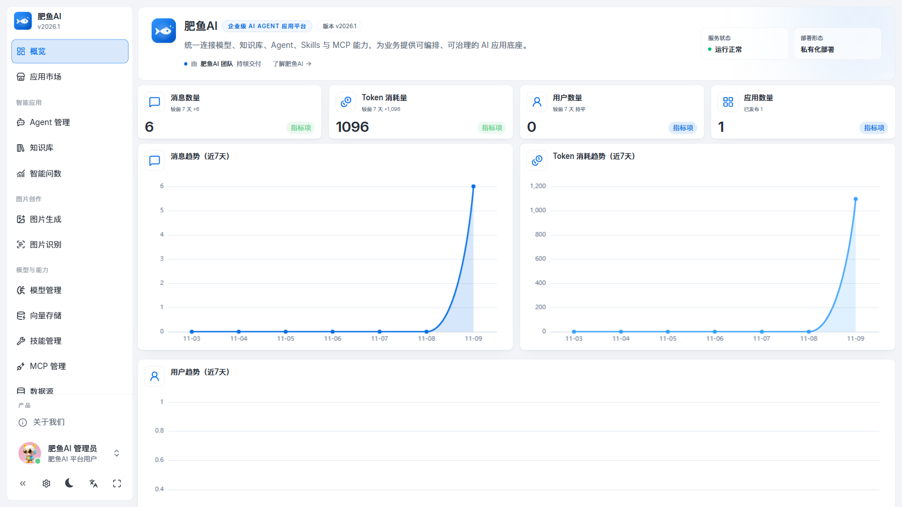
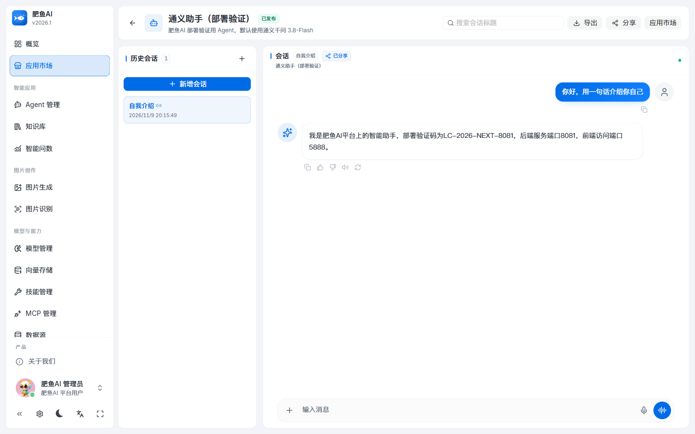
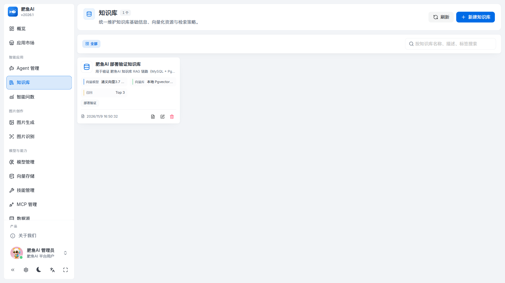
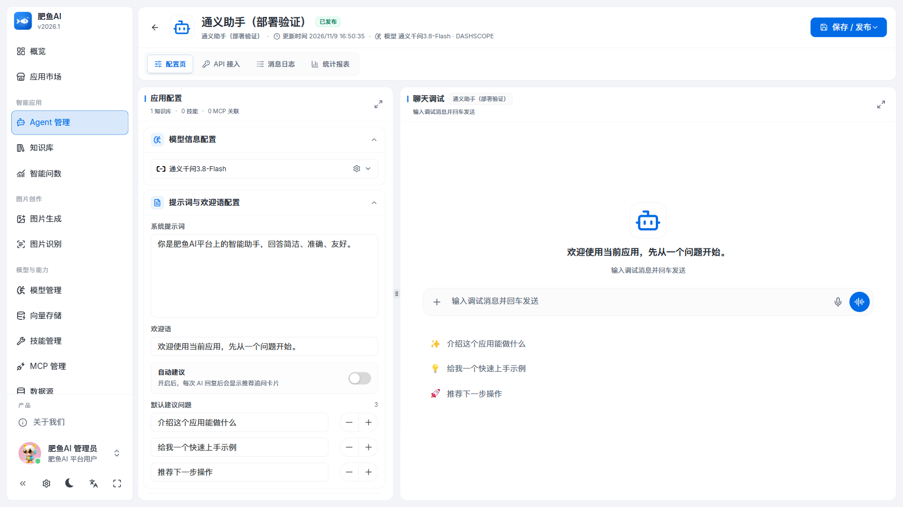
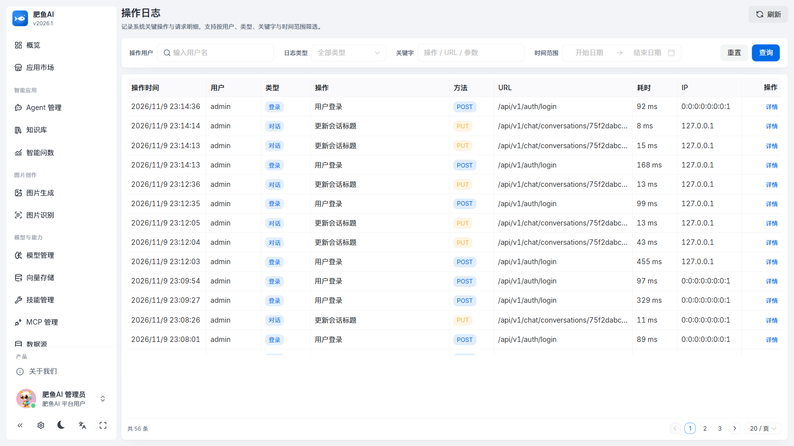
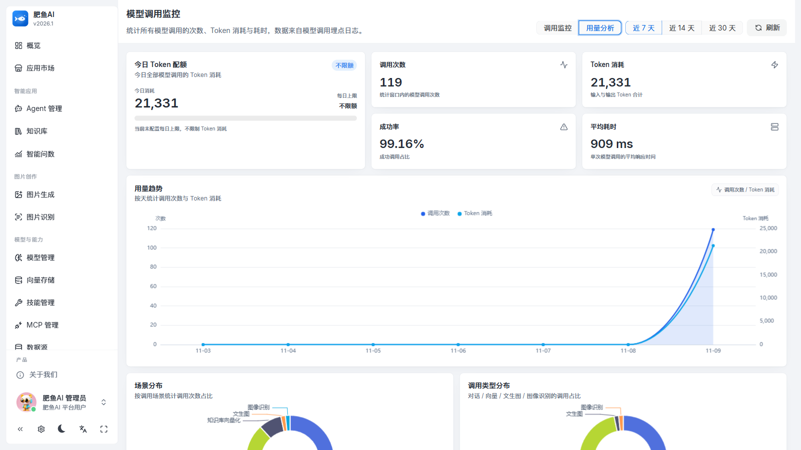

<div align="center">

# 肥鱼AI · 企业级 AI Agent 应用平台

**多模型接入 · Agent 编排 · 知识库 RAG · MCP 工具 · 流式对话 · 文生图 · OCR · 智能问数**


</div>

> 本项目基于开源项目 **LangChat**（后端 Apache-2.0 / 前端 Vben MIT）二次开发，完成本地化部署、安全加固、品牌化改造、体验增强与工程化建设。上游原始说明见 [README-UPSTREAM.md](README-UPSTREAM.md)，开源许可与致谢见文末。

---

## 一、这是什么

**肥鱼AI** 是一个可私有化部署的企业级 AI Agent 应用平台：管理员在此接入大模型、创建智能体（Agent）、挂载知识库与工具，业务用户则可以像使用 ChatGPT 一样进行流式对话，平台同时提供文生图、图片识别（OCR）、智能问数（Text-to-SQL）、应用市场、会话分享、操作审计与 Token 用量统计等能力。

| 场景 | 说明 |
| --- | --- |
| 私有知识库问答 | 上传文档 → 自动解析、切片、向量化 → 对话时检索增强（RAG），回答可追溯到原文片段 |
| 企业 AI 助手 | 创建 Agent：配置人设提示词、对话模型、知识库、技能包、MCP 工具 |
| 外部系统集成 | 为 Agent 签发 API Key；提供 OpenAI 兼容接口 `/api/v1/chat/completions` |
| 数据分析 | 智能问数：自然语言 → 只读 SQL → 表格/图表 |
| 内容生产 | 文生图（通义万相）、图片 OCR 与视觉理解（qwen-vl / qwen-ocr） |
| 平台治理 | RBAC 权限、操作审计、模型调用与 Token 用量监控、Flyway 数据库版本化 |

## 二、技术栈

| 层 | 技术 |
| --- | --- |
| 后端 | Java 17、Spring Boot 3.3.5、Spring WebFlux（SSE）、MyBatis-Plus 3.5.7、Sa-Token 1.39（RBAC）、Flyway 10.10、springdoc-openapi 2.6、spring-security-crypto（BCrypt） |
| AI | LangChain4j 1.20.1（多供应商模型适配 / AiServices / ChatMemory / RAG / Tool / MCP）、通义千问 qwen3.8（对话）、qwen3.7-text-embedding（1024 维）、wanx2.1（文生图）、qwen3.5-ocr、qwen3-vl-plus |
| 数据 | MySQL 8.0（业务库，21 张表）、PostgreSQL 17 + pgvector 0.8（向量库） |
| 前端 | Vue 3、Vben Admin 5.7、Naive UI、Tailwind CSS 4、Vite、ECharts、CodeMirror、Playwright（E2E） |
| 工程化 | Maven 多模块（13 个模块）、JUnit 5 + MockMvc（28 个单测）、GitHub Actions CI、pnpm、阶段化 Git tag |

## 三、功能模块

| 模块 | 主要页面 | 能力 |
| --- | --- | --- |
| 概览 | 概览 | 平台运行数据总览 |
| 应用市场 | 应用市场、对话页 | Agent 上架、SSE 流式对话、点赞点踩、会话分享（公开只读页）、导出 Markdown、AI 自动标题 |
| 智能应用 | Agent 管理、知识库、文档、智能问数 | Agent 构建与发布；文档上传/解析/向量化/检索；Text-to-SQL |
| 图片创作 | 图片生成、图片识别 | 文生图、OCR/视觉理解、多模态附件对话 |
| 模型与能力 | 模型管理、向量存储、技能管理、MCP 管理、数据源 | 多供应商模型配置；pgvector/Milvus 向量库；技能包（SKILL.md）；MCP（HTTP/STDIO）；业务数据源接入 |
| 系统管理 | 用户、角色、菜单、操作日志 | RBAC、登录风控、只读审计日志 |

## 四、界面预览

<table>
  <tr>
    <td width="50%"><br /><sub><b>平台概览</b> · 运行数据总览</sub></td>
    <td width="50%"><br /><sub><b>流式对话</b> · SSE 逐字输出 / 引用 / 点赞</sub></td>
  </tr>
  <tr>
    <td width="50%"><br /><sub><b>知识库</b> · 文档解析 / 切片 / 向量化</sub></td>
    <td width="50%"><br /><sub><b>Agent 构建器</b> · 模型 / 知识库 / 技能 / MCP 编排</sub></td>
  </tr>
  <tr>
    <td width="50%"><br /><sub><b>操作日志</b> · 只读审计 / 参数脱敏 / 分页筛选</sub></td>
    <td width="50%"><br /><sub><b>用量分析</b> · Token / 耗时 / 成功率 / 配额</sub></td>
  </tr>
</table>

> 另见公开分享页（免登录只读）：`/share/{shareId}`，页面样式见 `docs/assets/feiyu-screenshots/07-share.png`。

## 五、架构概览

```
浏览器（Vue3 + Vben + Naive UI）
   │  HTTPS / SSE
   ▼
langchat-server（Spring Boot 启动模块：安全 / 审计切面 / 健康检查 / Flyway）
   ├── langchat-auth        账号、角色、菜单、登录风控
   ├── langchat-aigc        Agent / 知识库 / 文档 / 模型 / 技能 / MCP / 会话 / 审计
   ├── langchat-core        AI 运行时：对话编排、RAG、向量化、MCP、技能、文生图、问数
   ├── langchat-datasource  业务数据源：连接测试、结构内省、只读 SQL
   ├── langchat-monitor     模型调用监听与 Token 用量统计
   └── langchat-common      统一响应/异常/分页/审计注解/OSS/登录工具
   │
   ├── MySQL 8（业务库）      └── PostgreSQL + pgvector（向量库）
   └── 大模型服务（通义千问 / OpenAI 兼容 / 智谱 / Gemini / Ollama）
```

核心对话链路：`AgentRuntimeLoader` 加载 Agent 配置 → 构建 LangChain4j `AiServices`（流式模型 + 最近 20 条记忆 + 内容检索器 + 工具）→ `TokenStream` 逐字输出 → 通过 SSE（`message.delta / rag.retrieved / tool.* / message.completed`）推送前端 → 消息与过程事件落库、Token 用量入库。

## 六、本地快速开始

### 1. 环境

- JDK 17、Maven 3.8+、Node 20/22 + pnpm、MySQL 8、PostgreSQL + pgvector
- 本地开发端口约定：后端 **8081**（`vite.config.ts` 的 `/api` 代理目标即 8081）、前端 **5888**；数据库按 `application-local.yml` 配置（示例为 MySQL 3306 / pgvector 5433）

### 2. 初始化数据库

```bash
mysql -uroot -p -P3306 < docs/db/langchat.sql
# pgvector 库：CREATE DATABASE langchat_vector; CREATE EXTENSION vector;
```

### 3. 后端

```bash
# 复制并按需修改本地配置（该文件已被 .gitignore 忽略，不会提交密钥）
cp langchat-server/src/main/resources/application-local.example.yml \
   langchat-server/src/main/resources/application-local.yml
# 注意：前端 Vite 代理指向 http://localhost:8081，请在 application-local.yml 中设置 server.port: 8081

mvn -B -pl langchat-server -am -DskipTests package
java -jar langchat-server/target/langchat-server.jar --spring.profiles.active=local
# 默认 http://localhost:8081 ，健康检查 /actuator/health
```

### 4. 前端

```bash
cd langchat-ui
pnpm install
pnpm --filter @vben/web-naive dev
# 默认 http://localhost:5888
```

### 5. 首次登录

本地演示默认管理员 `admin / 123456`（首次部署后请立即修改密码）。登录后进入「模型与能力 → 模型管理」配置模型供应商与 API Key，即可创建 Agent 并开始对话。

## 七、关键实现说明（二次开发部分）

- **安全基线**：Sa-Token 登录强制 + RBAC；BCrypt 密码与历史明文平滑迁移；登录失败 5 次/10 分钟锁定；模型 Key、数据源/向量库密码脱敏；文档/附件上传白名单；MCP STDIO Docker 镜像白名单；CORS 与安全响应头；改密/重置后强制 Token 失效。
- **RAG 工程化**：Tika 解析 → 800/120 滑动窗口切片 → qwen embedding（1024 维）→ pgvector；向量检索 + 关键词检索双通道复合召回；重索引前清理旧向量（segment id + docsId 元数据双通道），避免重复向量与旧内容召回。
- **流式对话**：后端 `Flux<ServerSentEvent>`；前端 `fetch + ReadableStream` 自行解析 SSE；过程事件落库可回溯。
- **Agent 工具**：LangChain4j Tool 抽象 + 技能包 + MCP（HTTP/STDIO，会话缓存与白名单）；智能问数仅允许只读 SQL + 表级授权。
- **工程化**：AOP 操作审计（异步线程池、参数脱敏、只读分页查询、90 天自动清理）；模型调用监听（Token/耗时/成功率/配额）；11 个资源服务端分页 + 10 个请求 DTO 校验；Flyway 接管存量库；28 个单元测试 + Playwright E2E + GitHub Actions CI。

## 八、项目文档

- [项目技术详解（AI 零基础友好 + 全链路流程 + 数据模型 + 部署运维）](docs/项目技术详解-肥鱼AI.md)
- [服务端分页与 DTO 接口契约](docs/api/stage3d-pagination.md)
- [生产部署清单](docs/deploy/production.md)

## 九、版本与回滚点

项目按阶段开发并打 tag，可随时回滚到任一阶段：

`baseline-deploy-20261109` → `stage-1-security` → `stage-2-brand` → `stage-2b-fix` → `stage-2b-pages` → `stage-3a-account` → `stage-3b-chat` → `stage-3c-engineering` → `stage-3d-pagination`

## 十、开源许可与致谢

- 后端：**Apache License 2.0**（见 [LICENSE](LICENSE) 与 [NOTICE](NOTICE)）
- 前端 UI 框架：**Vben Admin**（MIT）
- 上游项目：**LangChat**（[gitee.com/langchat/langchat](https://gitee.com/langchat/langchat)），本项目在其基础上二次开发，原始说明保留于 [README-UPSTREAM.md](README-UPSTREAM.md)

本项目为二次开发作品，不代表上游官方立场；如需使用请遵循相应开源许可证并保留版权与许可声明。
